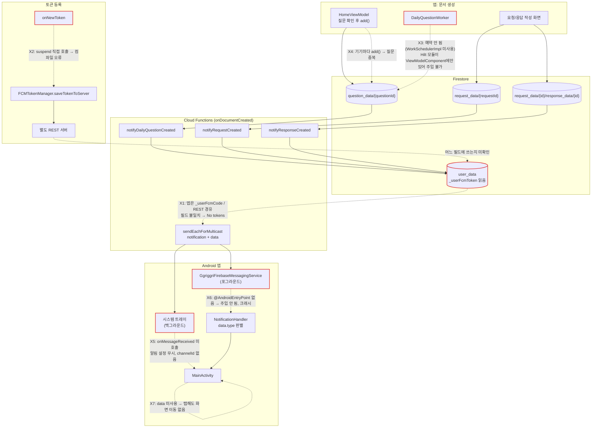

# 끼리끼리(ggrigggri) 코드 리뷰 — 서브에이전트 1차 시범 운영 결과 (2026-10-12)

이 문서는 2026-10-12에 `.claude/agents/`의 서브에이전트 7개를 시범 운영한 결과를 정리한 것입니다. 이전 리뷰는 [project_code_review_2026-04-14.md](./project_code_review_2026-04-14.md)를 참고하세요.

**표기 규칙**
- **직접 확인됨**: 메인 세션이 코드를 직접 열어 사실을 확인한 항목입니다.
- **재확인**: 이 문서를 쓰면서 docs-writer가 해당 파일·라인을 다시 열어 내용이 맞는지 본 항목입니다.
- 표시가 없는 항목은 에이전트 보고서에만 근거합니다. 정적 검토 결과이며 빌드나 실행으로 검증하지 않았습니다.

---

## 1. 개요

| 항목 | 내용 |
|---|---|
| 일자 | 2026-10-12 |
| 운영 방식 | 메인 세션이 서브에이전트 7개에 작업을 나눠 맡기고, 결과를 모아 정리 |
| 코드 변경 | 3개 에이전트, 커밋 3개 (`5bef8b7`, `b5a3d1a`, `e251be8`) |
| 진단만 수행 | 4개 에이전트 (코드 변경 없음) |

### 1-1. 에이전트별 역할

| 에이전트 | 수행 내용 | 산출물 |
|---|---|---|
| compose-ui-specialist | ModifyGroupName 화면을 Route / stateless Screen으로 분리 | 커밋 `5bef8b7` |
| viewmodel-refactorer | `runBlocking` 2곳 제거 | 커밋 `b5a3d1a` |
| test-writer | data 계층 Mapper 단위 테스트 작성 | 커밋 `e251be8` + 추가 발견 사항 |
| architecture-guardian | 모듈 경계, DI, 패키지 구조 진단 | 보고서 |
| firebase-backend-agent | Cloud Functions 점검(npm ci / lint / build 통과, deploy 안 함), FCM 페이로드와 수신 처리 대조 | 보고서 |
| build-config-agent | Gradle 설정, 버전 카탈로그, 비밀정보 파일 추적 여부 점검 | 보고서 |
| feature-scaffolder | "답변 이모지 리액션" 기능 설계안 작성 (코드 생성 안 함) | 설계안 |

docs-writer(이 문서 작성)까지 포함하면 `.claude/agents/`에 있는 에이전트는 모두 8개입니다.

### 1-2. 환경 제약

- 컨테이너에 Android SDK가 없고 Google Maven 접근도 막혀 있어 **Gradle 빌드와 테스트를 돌릴 수 없었습니다.**
- 그래서 모든 코드 변경은 정적 검토로만 확인했습니다. Mapper 테스트만 예외로, Gradle 대신 독립 실행한 kotlinc(2.0.21)와 JUnit으로 돌렸습니다(아래 2-3 참고).
- Cloud Functions는 Node 환경이라 `npm ci`, `lint`, `build`까지 돌렸습니다. 배포(deploy)는 하지 않았습니다.

---

## 2. 이번에 반영된 변경

### 2-1. `5bef8b7` ModifyGroupName 화면 Route / Screen 분리 (compose-ui-specialist)

- `ModifyGroupNameRoute`(`feature/ggriggri_ui/src/main/java/com/ahn/ggriggri/screen/ui/setting/ui/modifygroupname/ModifyGroupNameScreen.kt:43`)가 ViewModel 상태 수집과 스낵바 처리를 맡습니다. `ModifyGroupNameScreen`은 값과 콜백만 받는 stateless 함수가 되었습니다.
- `GroupNameTextField`를 따로 뽑아냈고, Preview 3개(기본 / 빈 입력 / 로딩)를 추가했습니다.
- `GgriggriNavigationGraph.kt`에서는 호출부만 Route로 바꿨습니다. 동작은 그대로입니다.
- 남은 부분
  - 하드코딩 색상은 대응하는 테마 토큰이 없어 그대로 두고 주석만 달았습니다.
  - `ggriggri_ui` 모듈에 `res/`가 없어 문자열 리소스화는 하지 않았습니다.
  - 같은 방식으로 정리할 다음 후보는 ModifyGroupPw 화면입니다.

### 2-2. `b5a3d1a` `runBlocking` 제거 (viewmodel-refactorer)

| 위치 | 변경 전 | 변경 후 | 동작 차이 |
|---|---|---|---|
| `NotificationHandler` (`data/src/main/java/com/ahn/data/fcm/NotificationHandler.kt:24-27`) | FCM 콜백 스레드에서 `runBlocking`으로 알림 설정 조회 | Singleton이 소유한 scope(`SupervisorJob` + `Dispatchers.IO.limitedParallelism(1)` + 예외 핸들러)에서 설정을 확인한 뒤 알림 표시. 표시 여부를 판단하는 로직은 같음 | `onMessageReceived`가 먼저 끝나고 알림은 조금 뒤에 뜸. 그 사이 프로세스가 죽으면 이론상 알림이 빠질 수 있음 |
| `HomeViewModel.getUserName` (`feature/ggriggri_ui/src/main/java/com/ahn/ggriggri/screen/ui/main/viewmodel/HomeViewModel.kt:428`) | `runBlocking`으로 감싼 일반 함수를 컴포지션 중에 호출 | `suspend` 함수로 바꿈. `ActiveRequestCard`(`.../home/component/requestcard/ActiveRequestCard.kt:37`)는 `produceState(key1 = request.requestUserDocumentID)`로 이름을 불러옴 | 메인 스레드 블로킹(ANR 위험)이 없어짐. 대신 이름이 잠깐 비어 있다가 채워짐 |

- 변경 후 프로젝트 전체에 `runBlocking`이 하나도 없습니다.
- 2026-04-14 리뷰에서 "매우 상"으로 분류했던 항목(2-1)이 이것으로 해결되었습니다.

### 2-3. `e251be8` Mapper 단위 테스트 도입 (test-writer)

- 위치: `data/src/test/java/com/ahn/data/mapper/` (7개 파일, 44케이스)
- 대상: Answer, Group, Question, QuestionList, Request, Response, User Mapper
- 검증 내용: 정상 변환, 기본값, Firestore 맵 키, 왕복 변환(DTO ↔ domain)
- 기존 의존성인 JUnit4만 썼습니다.
- 실행 방법: Gradle을 쓸 수 없어 독립 실행한 kotlinc(2.0.21)와 JUnit으로 돌렸고, Firestore 어노테이션은 스텁으로 대신했습니다. 44개 모두 통과했습니다. **Gradle로 돌린 결과는 아직 없으므로**, SDK가 있는 환경에서 `./gradlew :data:testDebugUnitTest`로 다시 확인해야 합니다.
- ViewModel 테스트와 UseCase 테스트는 아직 없습니다. 그래서 "테스트 부족" 항목은 일부만 해결된 상태입니다.

---

## 3. 새로 발견한 문제 (중요도별)

**중요도 분류 기준**: 원자료에 표시된 등급을 따랐습니다(긴급·치명 → 치명, 높음·상 → 상, 중간 → 중, 낮음 → 하). 원자료에 등급이 없는 항목은 2026-04-14 리뷰의 등급을 따랐고, 거기에도 없으면 docs-writer가 판단했습니다. 판단으로 정한 항목은 비고에 "(등급 추정)"이라고 적었습니다.

**담당 에이전트**: `.claude/agents/`에 실제로 있는 8개(architecture-guardian, build-config-agent, compose-ui-specialist, docs-writer, feature-scaffolder, firebase-backend-agent, test-writer, viewmodel-refactorer) 중에서만 골랐습니다.

### 3-1. 치명

| # | 파일:라인 | 내용 | 확인 | 담당 |
|---|---|---|---|---|
| C1 | `functions/src/index.ts:72,82,115` / `data/src/main/java/com/ahn/data/remote/dto/UserDTO.kt:11` | **FCM 토큰 필드 이름이 서로 다릅니다.** Functions는 `user_data`의 `_userFcmToken`을 읽고, 앱 DTO의 필드는 `_userFcmCode`입니다. 게다가 앱은 토큰을 Firestore에 직접 쓰지 않고 별도 REST 서버로 보냅니다(`FirestoreUserRepositoryImpl.kt:62-66`, `apiService.updateFCMToken`). REST 서버가 `_userFcmToken`을 채우지 않는다면 모든 푸시가 "No tokens"로 끝납니다. | 직접 확인됨 / 재확인 | firebase-backend-agent |
| C2 | `data/src/main/java/com/ahn/data/fcm/GgriggriFirebaseMessagingService.kt:21-25` | 일반 함수인 `onNewToken`에서 `suspend fun saveTokenToServer`(`FCMTokenManager.kt:46`)를 바로 호출합니다. **컴파일 오류**가 납니다. | 직접 확인됨 / 재확인 | firebase-backend-agent |
| C3 | `secret.properties` (저장소 루트) | 비밀정보 파일이 **git에 추적되고 있고**, `.gitignore`에도 들어 있지 않습니다. 에이전트는 파일 내용을 열어보지 않았습니다. `git rm --cached`로 추적을 끊고, 들어 있던 키를 교체할지 검토해야 합니다. | 직접 확인됨 / 재확인 | build-config-agent |

### 3-2. 상

| # | 파일:라인 | 내용 | 확인 | 담당 |
|---|---|---|---|---|
| H1 | `data/src/main/java/com/ahn/data/di/FirestoreRepositoryModule.kt:25`, `data/src/main/java/com/ahn/data/di/FirestoreDataSourceModule.kt:26` | Firestore Repository / DataSource Hilt 모듈이 `ViewModelComponent`에만 설치되어 있습니다. 그래서 `DailyQuestionWorker`에 Repository를 주입할 수 없습니다. | 직접 확인됨 / 재확인 | architecture-guardian(진단) → firebase-backend-agent(수정) |
| H2 | `data/src/main/java/com/ahn/data/fcm/GgriggriFirebaseMessagingService.kt:7-13` | `@AndroidEntryPoint`가 없어 `@Inject lateinit` 필드가 주입되지 않습니다. 메시지를 받으면 `UninitializedPropertyAccessException`으로 크래시가 납니다. architecture-guardian과 firebase-backend-agent가 각자 따로 이 문제를 찾았습니다. | 직접 확인됨 / 재확인 | firebase-backend-agent |
| H3 | `feature/ggriggri_ui/src/main/java/com/ahn/ggriggri/screen/ui/main/worker/WorkSchedulerImpl.kt:13-14` | Worker가 아닌 클래스에 `@HiltWorker` / `@AssistedInject`가 붙어 있습니다. 이 클래스를 호출하는 곳도 없어서 **일일 질문 Worker가 예약되지 않습니다.** | 재확인 | firebase-backend-agent |
| H4 | `functions/src/index.ts:135` | 세 트리거 모두 `notification{title, body}` + `data` 형태로 보냅니다. 이렇게 `notification` 페이로드가 있으면 앱이 백그라운드일 때 `onMessageReceived`가 불리지 않으므로, 앱의 알림 설정(on/off)이 무시되고 `channelId`도 지정되지 않습니다. | 재확인 | firebase-backend-agent |
| H5 | `HomeViewModel` / `DailyQuestionWorker.kt:123`, `FirestoreQuestionDataSourceImpl.kt:26` | **일일 질문이 중복 생성됩니다.** HomeViewModel과 Worker가 기기마다 "있는지 확인한 뒤 `add()`(랜덤 ID)"로 질문을 만들기 때문에 질문과 푸시가 여러 번 생깁니다. 권장안은 `${groupId}_${yyyyMMdd}` 고정 ID에 `create()`나 트랜잭션을 쓰는 방식, 또는 서버의 `onSchedule`로 옮기는 방식입니다. | 재확인(`add()` 사용 부분) | firebase-backend-agent |
| H6 | `feature/ggriggri_ui/build.gradle.kts:47` | feature가 data에 의존합니다(`implementation(project(":data"))`). OAuthViewModel, RequestViewModel, ResponseViewModel이 data 패키지를 import합니다. 2026-04-14 리뷰 1-1에서 지적한 문제가 아직 남아 있습니다. | 재확인 | architecture-guardian(진단) → viewmodel-refactorer(수정) |

### 3-3. 중

| # | 파일:라인 | 내용 | 확인 | 담당 |
|---|---|---|---|---|
| M1 | `app/src/main/AndroidManifest.xml` | 기본 `WorkManagerInitializer`를 끄는 설정(`tools:node="remove"`)이 없습니다. 그래서 `HiltWorkerFactory`(`ggriggriAplication.kt:34`)가 쓰이지 않습니다. | 재확인(Manifest에 `provider`/`startup` 항목 없음) | firebase-backend-agent |
| M2 | `feature/ggriggri_ui/src/main/java/com/ahn/ggriggri/screen/ui/main/worker/DateChangeNotifier.kt:30` | `GlobalScope.launch`를 사용합니다. | 재확인 | viewmodel-refactorer |
| M3 | 프로젝트 전반 | `jakarta.inject`와 `javax.inject`를 섞어 씁니다(예: `GgriggriFirebaseMessagingService.kt:5`는 jakarta). | 재확인 | architecture-guardian |
| M4 | `feature/ggriggri_ui/src/main/java/com/ahn/ggriggri/screen/ui/main/viewmodel/HomeViewModel.kt:75-90, 391-403` | 중첩 `collect`: `init`에서 `loadRequests()`를 반복 호출하는데, 호출할 때마다 이전 `collect`가 취소되지 않고 쌓입니다. | 재확인 | viewmodel-refactorer |
| M5 | 23개 파일, `feature/common_ui/src/main/java/theme/Color.kt:1` 등 | 패키지 선언과 파일 경로가 맞지 않습니다. common_ui에는 루트 패키지 `package theme`도 있습니다. | 재확인(`package theme` 부분) | architecture-guardian |
| M6 | `feature/build.gradle.kts:9`, `feature/common_ui/build.gradle.kts:10` | compileSdk가 35이고 나머지 모듈은 36입니다. 36으로 통일하기를 권장합니다. | 재확인 | build-config-agent |
| M7 | `gradle/libs.versions.toml` | Firebase BOM 34부터 KTX 모듈이 폐지되었으므로 KTX가 아닌 아티팩트로 바꿔야 합니다. compose runtime 버전이 1.9.0으로 고정되어 BOM과 맞지 않습니다. `jetbrainsKotlinJvm` 2.1.21과 `kotlin` 2.2.10이 섞여 있습니다. | - | build-config-agent |
| M8 | `gradle/libs.versions.toml:143`, `app/build.gradle.kts:80`, `data/build.gradle.kts:55`, `domain/build.gradle.kts:16` | `moshi-kotlin-codegen`이 `moshi-libraries` 번들 안에 들어 있고, 이 번들이 `ksp`가 아니라 `implementation`으로 선언되어 있습니다. 그래서 어댑터가 생성되지 않습니다. | 재확인 | build-config-agent |
| M9 | `functions/src/index.ts` / `app/src/main/java/com/ahn/ggrigggri/MainActivity.kt` | 클라이언트는 `data.type`만 읽습니다(`NotificationHandler.kt:34`). `type` 값(daily_question / request / response)은 서버와 맞지만, 나머지 `data`는 MainActivity가 읽지 않아 **알림을 눌러도 해당 화면으로 이동하지 않습니다.** | - | firebase-backend-agent |
| M10 | `functions/src/index.ts` (`pruneInvalidTokens`) | 유효하지 않은 토큰을 정리할 때 `user_data` 컬렉션 전체를 조회합니다. | - | firebase-backend-agent |
| M11 | `ActiveRequestCard`, `DefaultRequestCard`, `DynamicButton` | 하위 컴포넌트에 ViewModel을 통째로 넘깁니다(2026-04-14 리뷰 3-1과 같은 문제). | - | compose-ui-specialist |
| M12 | domain 모듈 | UseCase가 하나도 없습니다. HomeViewModel의 의존성이 7개입니다. UseCase 후보는 `GetOrCreateTodayQuestionUseCase`(Worker와 HomeViewModel에 중복된 로직), `GetRequestsWithUserNameUseCase`, `LoginUseCase`입니다. | - | viewmodel-refactorer (등급 추정) |
| M13 | `core/`, `app/common/`(Java 11), 루트 `:feature` 모듈 | 고립된 모듈이 있습니다. 루트 `:feature` 모듈에는 소스가 없습니다. 삭제를 권장하지만 사용자가 결정해야 합니다(4장). | - | build-config-agent |

### 3-4. 하

| # | 파일:라인 | 내용 | 확인 | 담당 |
|---|---|---|---|---|
| L1 | `functions/src/index.ts:139` | `sendEachForMulticast`를 호출할 때 500개 단위로 나눠 보내지 않습니다. | - | firebase-backend-agent |
| L2 | `functions/src/index.ts` | 일일 질문 알림 문구만 영어입니다. | - | firebase-backend-agent |
| L3 | `gradle/libs.versions.toml`, 각 `build.gradle.kts` | 쓰지 않는 의존성이 있습니다. Glide와 glide plugin은 import가 0건입니다(APNG는 penfeizhou 라이브러리를 직접 씀). app의 moshi와 firestore-ktx도 쓰지 않습니다. appcompat / material(View 기반)도 import가 0건입니다. 중복된 버전 키와 alias도 많습니다. | - | build-config-agent |
| L4 | `data/src/main/java/com/ahn/data/mapper/QusetionDataMapper.kt` | 파일명 오타(Qusetion → Question)가 있고, 쓰지 않는 import도 있습니다. | 재확인(파일명) | test-writer |
| L5 | `RequestDataMapper` / `FirestoreRequestDataSourceImpl.kt:33` | Request만 맵에 `_requestId`를 저장하는데, `add()`로 문서를 만들기 때문에 저장되는 값에 의미가 없습니다. DTO의 id 필드도 쓰이지 않습니다. | - | test-writer |
| L6 | `UserDataMapper.kt:12` | User의 FCM 토큰 리스트를 복사하지 않고 같은 참조를 공유합니다. | - | test-writer |
| L7 | `domain/src/main/java/com/ahn/domain/model/Request.kt:19`, `FirestoreRequestDataSourceImpl.kt:67,106` | Request의 시간 계산이 `System.currentTimeMillis()`를 직접 호출합니다. 30분 제한 로직을 테스트하려면 Clock을 주입받도록 바꿔야 합니다. | 재확인 | test-writer |
| L8 | `OAuthViewModel` | ViewModel이 `Activity`를 파라미터로 받습니다(2026-04-14 리뷰 2-3과 같은 문제). | - | viewmodel-refactorer |

---

## 4. 사용자 결정이 필요한 항목

1. **secret.properties 처리**: 추적을 끊을지(`git rm --cached` + `.gitignore`에 추가)와 들어 있던 키를 교체할지. 이미 커밋 이력에 남아 있기 때문에 추적만 끊어서는 노출을 되돌릴 수 없습니다.
2. **FCM 토큰 저장 경로 통일**: REST 서버가 토큰을 어느 필드에 저장하는지 확인해야 합니다. 그다음 다음 중 하나를 고릅니다.
   - (a) 앱이 Firestore `user_data`에 직접 쓰고 필드 이름을 하나로 맞춘다
   - (b) REST 서버가 Functions가 읽는 필드에 쓰도록 맞춘다
3. **firestore.rules 관리 방식**: 저장소에 `firestore.rules`가 없습니다. 콘솔에서 직접 관리하는지 확인이 필요합니다.
4. **일일 질문 생성 주체**: 클라이언트(HomeViewModel + Worker)에서 고정 ID로 계속 만들지, 서버의 `onSchedule` 함수로 옮길지.
5. **고립 모듈 삭제**: `core/`, `app/common/`, 소스가 없는 루트 `:feature` 모듈을 지울지.
6. **"답변 이모지 리액션" 기능 진행 여부**: feature-scaffolder가 설계안을 냈고, 사용자가 정해야 할 것이 8가지 있습니다(저장 구조, 이모지 범위, 1인 1개 여부, 보안 규칙 등).
   - 설계안 요약: archive의 `QuestionAnswerScreen`(AnswerItem)에 ReactionBar를 붙이고, 새 route는 만들지 않습니다.
   - 저장 경로: `question_data/{q}/answer_data/{a}/reaction_data/{userId}`. 문서 ID를 userId로 해서 1인 1리액션을 보장합니다.
   - 계층별 추가: domain에 `AnswerReaction`, `AnswerReactionRepository`, usecase 패키지(Toggle / Get UseCase)를 처음 만듭니다. data에 DTO / Mapper / DataSource / RepositoryImpl과 DI `@Binds`를 추가합니다. 알림 연동은 firebase-backend-agent가 맡습니다.
7. **Android SDK 설치**: 클라우드 환경에서 빌드를 검증하려면 SessionStart 훅 등으로 SDK를 설치할지 검토해야 합니다.

---

## 5. 다음 단계 권장 순서

1. **비밀정보 처리** (C3) — 사용자 결정 1 이후 build-config-agent가 진행
2. **알림 경로 복구** — firebase-backend-agent
   1. `onNewToken` 컴파일 오류 수정 (C2)
   2. `@AndroidEntryPoint` 추가 (H2)
   3. 토큰 필드와 저장 경로 통일 (C1, 사용자 결정 2 이후)
3. **일일 질문 파이프라인 정리** — firebase-backend-agent
   - Hilt 모듈을 `SingletonComponent`로 옮김 (H1)
   - WorkSchedulerImpl 정리와 호출부 연결 (H3)
   - Manifest의 WorkManager 초기화 설정 (M1)
   - 고정 ID로 중복 방지 (H5, 사용자 결정 4 이후)
4. **FCM 페이로드 정리** (H4, M9) — data-only 메시지로 바꾸고 알림 탭 시 화면 이동 처리. firebase-backend-agent
5. **Android SDK가 있는 환경에서 빌드와 `e251be8` 테스트 재검증** — test-writer
6. **구조 개선** — feature→data 의존 제거 (H6), 중첩 collect (M4), UseCase 도입 (M12). viewmodel-refactorer가 진행하고 architecture-guardian이 검토
7. **빌드 설정 정리** (M6~M8, M13, L3) — build-config-agent
8. **UI 정리** — ModifyGroupPw 화면 분리, 하위 컴포넌트에 ViewModel 넘기는 코드 제거 (M11). compose-ui-specialist

---

## 6. 알림 흐름과 현재 끊긴 지점

| 끊긴 지점 | 대응 항목 |
|---|---|
| X1 토큰 필드 불일치 | C1 |
| X2 onNewToken 컴파일 오류 | C2 |
| X3 Worker 미예약 / 주입 불가 | H1, H3, M1 |
| X4 질문 중복 생성 | H5 |
| X5 백그라운드 수신 시 설정 무시 | H4 |
| X6 Service 주입 실패 | H2 |
| X7 알림 탭 시 화면 이동 없음 | M9 |

---

## 7. 해결된 기존 항목

| 기존 항목 | 상태 |
|---|---|
| `HomeViewModel` / `NotificationHandler`의 `runBlocking` (04-14 리뷰 2-1, 구조 가이드 2-2) | ✅ 해결 (`b5a3d1a`, 2026-10-12) |
| MainActivity 권한 런처 초기화 (구조 가이드 2-7) | ✅ 해결. `MainActivity.kt:36`에서 `registerForActivityResult`로 초기화합니다. 이 코드는 `9892566`(2026-05-17)에 들어갔고, 2026-10-12에 architecture-guardian이 해결된 것을 확인했습니다. |
| domain 모듈 순수성 | domain에 android / firebase import가 없는 것을 architecture-guardian이 확인했습니다. |
| 테스트 부족 (구조 가이드 2-8, 4장 5단계) | ✅ 일부 해결 (`e251be8`, 2026-10-12). Mapper 테스트만 있고 ViewModel / UseCase 테스트는 아직 없습니다. |

---

## 8. 에이전트 운영 소감 (메인 세션)

- 보고서가 짚은 경로와 라인이 정확했습니다. 같은 문제(`@AndroidEntryPoint` 누락, WorkScheduler)를 여러 에이전트가 각자 찾아내기도 했습니다.
- 일부 에이전트가 존재하지 않는 에이전트 이름(예: di-hilt-agent)을 후속 담당으로 추천했습니다. 앞으로는 프롬프트에 "실제로 있는 8개 중에서 추천"이라고 명시해야 합니다.
- Android SDK가 없는 클라우드 환경에서는 빌드를 검증할 수 없습니다. SessionStart 훅으로 SDK를 설치하는 방안을 검토해야 합니다.
